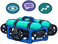

<div align="center">

<a href="https://sky-zhu-91.github.io/NereidVLA/">
  
</a>

# NereidVLA
## Learning to Understand and Navigate the Underwater World

**Transferring marine spatial knowledge to language-conditioned 3D underwater navigation.**

[](https://sky-zhu-91.github.io/NereidVLA/)
[](https://arxiv.org/abs/2611.24864)
[](https://arxiv.org/pdf/2611.24864)
[](https://github.com/SKY-Zhu-91/NereidVLA)


<p>
  Chenjie Zhao<sup>1,&#42;</sup>,
  Zhiliang Zhu<sup>2,&#42;,†,‡</sup>,
  Quan Chen<sup>1</sup>,
  Yuquan Xue<sup>3</sup>,
  Xingxue Shi<sup>4</sup>,
  Puyue Wang<sup>5</sup>,
  Zhiqiang Zhao<sup>2</sup>,
  Kangye Zheng<sup>2</sup>,
  Boyang Xu<sup>2</sup>,
  Mingwei Lin<sup>1,†</sup>,
  Dejun Li<sup>1</sup>
</p>

<p>
  <sup>1</sup>Zhejiang University ·
  <sup>2</sup>Harbin Engineering University ·
  <sup>3</sup>Nanyang Technological University<br>
  <sup>4</sup>Harbin Institute of Technology ·
  <sup>5</sup>University of Auckland
</p>

<p>
  <sup>&#42;</sup>Equal contribution (co-first authors) ·
  <sup>†</sup>Corresponding authors ·
  <sup>‡</sup>Project leader
</p>

</div>

---

## Overview

**Can spatial knowledge learned from marine observations support
language-conditioned 3D underwater navigation?**

NereidVLA investigates this question through a two-stage learning framework.
First, **Sea2Know** learns navigation-relevant spatial knowledge from
approximately **two million marine vision-language examples**, without
paired robot trajectories. We then adapt Sea2Know into **NereidVLA**
using expert trajectories executed under simulated underwater vehicle
dynamics.

Given **four historical RGB observations and a language instruction**,
NereidVLA predicts discrete motion tokens that decode into **ten local
3D waypoints over a five-second horizon**. A low-level feedback
controller tracks the predicted trajectory, while updated visual
observations support replanning and closed-loop execution.

<p align="center">
  
</p>

## Highlights

- **Spatial knowledge before motion learning.**
  Sea2Know learns target grounding, spatial relations, depth ordering,
  scene structure, and temporal changes from marine observations.

- **Dynamics-grounded trajectory supervision.**
  Navigation targets come from executed expert motion under simulated
  vehicle dynamics, rather than directly from geometric reference paths.

- **Visual-language input and 3D trajectory output.**
  The VLA receives RGB histories and language instructions and predicts
  local body-frame trajectories through discrete motion tokens.

- **Evaluation from understanding to execution.**
  Experiments cover underwater spatial understanding, offline trajectory
  prediction, closed-loop simulation, and physical robot navigation.

- **Transfer to a physical underwater robot.**
  NereidVLA achieves **78.75% success** in laboratory-pool trials
  without fine-tuning on data from the real test environment.

## Method

### Stage 1: Marine Spatial Knowledge Learning

We train **Sea2Know** through full-parameter supervised fine-tuning of
Qwen3-VL-Instruct backbones at **2B, 4B, and 8B** scales.

Approximately two million marine vision-language examples are constructed
using annotations and question-answer formats from **NAUTILUS** and
**USI-Brain**, together with underwater simulation scenes.

The supervision covers:

- Target grounding and object localization.
- Relative spatial relationships and depth ordering.
- Passage and scene structure.
- Multi-frame changes in target position, visibility, and apparent size.

This stage does not require paired robot-motion supervision.
**Sea2Know (8B)** initializes the navigation model.

### Stage 2: Trajectory-Supervised Navigation Adaptation

We collect expert demonstrations in **MarineGym** across four tasks:

1. Obstacle avoidance.
2. Target search and approach.
3. Pipeline navigation.
4. Cave navigation.

Task-specific geometric planning generates feasible reference paths.
An expert controller follows these paths under simulated underwater
vehicle dynamics. The resulting executed trajectories provide the
training targets.

NereidVLA learns to predict motion tokens autoregressively using its
native language-model head. During navigation adaptation, the visual
encoder is frozen, while the language model, token embeddings, and
LM head are updated without LoRA.

### Trajectory Representation and Execution

| Component | Specification |
|---|---|
| Visual input | Four front-facing RGB observations |
| Observation times | −1.5 s, −1.0 s, −0.5 s, and the current time |
| Language input | Navigation instruction |
| Prediction horizon | 5 seconds |
| Output | 10 local 3D waypoints at 0.5-second intervals |
| Coordinate frame | Robot body frame fixed at decision time |
| Axis convention | Forward–left–up |
| Motion codebook | 1,024 displacement entries |
| Tokenization | Residual-aware displacement quantization |
| Execution | Receding-horizon prediction and feedback tracking |

Residual-aware tokenization selects each codeword according to the
difference between the target position and the previously reconstructed
position. This allows later tokens to compensate for earlier
quantization errors.

**Robot state estimates are used for trajectory supervision and
low-level control, not as inputs to the VLA policy.**

## Data and Benchmark

### Navigation Demonstrations

The simulated environments span seabeds, fixed underwater facilities,
pipelines, aquaculture cages, and caves.

| Item | Scale |
|---|---:|
| Scene pool for demonstration collection | 573 scenes |
| Collected expert demonstrations | 5,117 |
| Scenes used for training samples | 516 |
| Demonstrations used for training samples | 4,597 |
| Navigation training samples | 100,000 |
| Validation samples | 18,726 |
| Offline test samples | Approximately 10,000 |
| Independent held-out evaluation scenes | 50 |

The held-out scenes contain unseen assets, layouts, and structures.

### Underwater Navigation Understanding Benchmark

The benchmark contains **3,646 questions**, retained from 4,500
candidates after independent annotation and cross-checking by three
trained annotators. It is disjoint from Stage 1 training data.

| Dimension | Abbreviation | Evaluation focus |
|---|---|---|
| Target grounding | TGA | Grounding task-relevant targets |
| Spatial relations | SRA | Understanding relative spatial relationships |
| Passage structure | TSA | Understanding passage geometry and structure |
| Traversability prediction | TPA | Judging visually traversable space |
| Temporal understanding | TUA | Understanding changes across observations |
| Local action decisions | LADA | Selecting visually plausible local actions |

TPA and LADA assess visual judgments rather than robot-specific
dynamic feasibility.

## Results

All results below are reported in
[the paper](https://arxiv.org/abs/2611.24864).

### 1. Underwater Spatial Understanding

Accuracy (%), higher is better.

| Model | TGA | SRA | TSA | TPA | TUA | LADA |
|---|---:|---:|---:|---:|---:|---:|
| Qwen3-VL-8B-Instruct | 63.18 | 53.38 | 66.75 | 64.76 | 38.82 | 16.35 |
| **Sea2Know (8B)** | **67.66** | **75.21** | **78.30** | **77.83** | **67.79** | **31.61** |
| Improvement (percentage points) | +4.48 | +21.83 | +11.55 | +13.07 | +28.97 | +15.26 |

Sea2Know improves over its size-matched backbone across all six
dimensions. The largest gains are in temporal understanding and
spatial relations.

### 2. Offline Trajectory Prediction

Errors are measured in meters; lower is better.
The table shows selected baselines from Table 2 of the paper.

| Model | ADE ↓ | FDE ↓ | Z MAE ↓ | ADE P95 ↓ | FDE P95 ↓ |
|---|---:|---:|---:|---:|---:|
| Qwen3-VL-8B | 0.29121 | 0.55396 | 0.06181 | 0.91134 | 1.66065 |
| Qwen3-VL-32B | 0.19766 | 0.38996 | 0.05219 | 0.64042 | 1.20181 |
| InternVLA-N1 | 0.20008 | 0.39498 | 0.05735 | 0.67412 | 1.26874 |
| SimpleVLN (8B) | 0.18501 | 0.37259 | 0.05424 | **0.57398** | 1.09097 |
| **NereidVLA (8B)** | **0.18082** | **0.34970** | **0.04658** | 0.59726 | **1.06058** |

NereidVLA achieves the lowest errors on four of the five reported
metrics. SimpleVLN obtains a lower ADE P95.

### 3. Closed-Loop Navigation in Simulation

Each model is evaluated on **500 executions**:
four tasks × 25 instances × five water and lighting conditions.

| Model | Obstacle avoidance | Target search / approach | Pipeline navigation | Cave navigation | Overall SR ↑ |
|---|---:|---:|---:|---:|---:|
| Qwen3-VL-8B | 84.00 | 52.00 | 71.20 | 82.40 | 72.40 |
| Qwen3-VL-32B | 76.00 | 44.00 | 59.20 | 65.60 | 61.20 |
| SimpleVLN (8B) | 74.40 | 38.40 | 52.00 | 41.60 | 51.60 |
| InternVLA-N1 | 83.20 | 46.40 | **87.20** | 76.00 | 73.20 |
| NAUTILUS (7B) | 79.20 | 47.20 | 83.20 | 61.60 | 67.80 |
| **NereidVLA** | **85.60** | **81.60** | 86.40 | **84.00** | **84.40** |

All success rates are percentages. The table shows navigation-adapted
models; the paper also reports transfer evaluations of the original
U0 and π₀.₅-USIM checkpoints.

NereidVLA also achieves:

- **81.85% Grid-SPL** for success-weighted path efficiency.
- **1.0658 m/s³ Jerk RMS** for translational motion smoothness.

Under matched downstream training and execution settings,
Sea2Know initialization increases success from **72.4% to 84.4%**
over direct navigation adaptation of Qwen3-VL-8B:
an improvement of **12.0 percentage points**.

### 4. Real-Robot Navigation

We evaluate a **BlueROVHeavy** robot in a laboratory pool, with
20 trials per task and **80 trials per model**.

**No data from the real test environment are used for fine-tuning.**

| Model | Target approach | Obstacle avoidance | Goal approach with obstacles | Narrow-passage avoidance | Overall SR ↑ |
|---|---:|---:|---:|---:|---:|
| Qwen3-VL-8B | 35.00 | 80.00 | 15.00 | 10.00 | 35.00 |
| InternVLA-N1 | 60.00 | 85.00 | 30.00 | 15.00 | 47.50 |
| **NereidVLA** | **90.00** | **95.00** | **70.00** | **60.00** | **78.75** |

All success rates are percentages.

NereidVLA completes **63 of 80 trials**, improving overall success
by **31.25 percentage points** over InternVLA-N1.

The physical system uses RGB observations from a RealSense D435i,
asynchronous inference on a remote RTX 4090 server, and low-level
tracking with IMU-supported state estimation, PID feedback, and
dynamics feedforward.

## Citation

If you find this work useful, please cite:

```bibtex
@misc{zhao2026nereidvla,
  title         = {{NereidVLA}: Learning to Understand and Navigate the Underwater World},
  author        = {Chenjie Zhao and Zhiliang Zhu and Quan Chen and Yuquan Xue and Xingxue Shi and Puyue Wang and Zhiqiang Zhao and Kangye Zheng and Boyang Xu and Mingwei Lin and Dejun Li},
  year          = {2026},
  eprint        = {2611.24864},
  archivePrefix = {arXiv},
  primaryClass  = {cs.CV},
  url           = {https://arxiv.org/abs/2611.24864}
}
```

## Acknowledgments

This work builds on Qwen3-VL, marine vision-language resources from
NAUTILUS and USI-Brain, and the MarineGym simulation platform.
Our motion-token representation is informed by AutoVLA.

We thank the authors and contributors of these projects.

## Contact

- **Chenjie Zhao:** [zhao_chenjie@zju.edu.cn](mailto:zhao_chenjie@zju.edu.cn)
- **Zhiliang Zhu:** [zhuzhiliang@hrbeu.edu.cn](mailto:zhuzhiliang@hrbeu.edu.cn)
